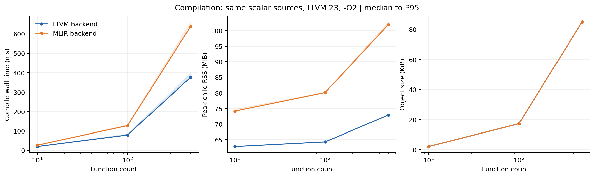
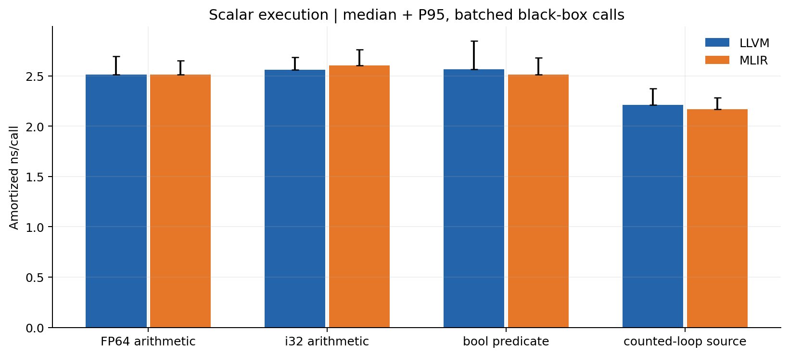
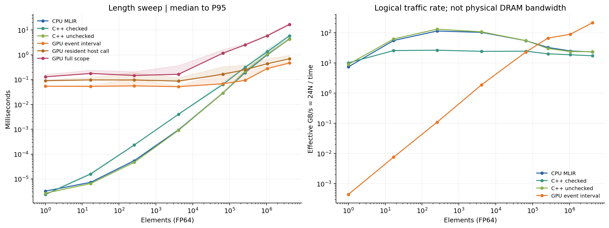
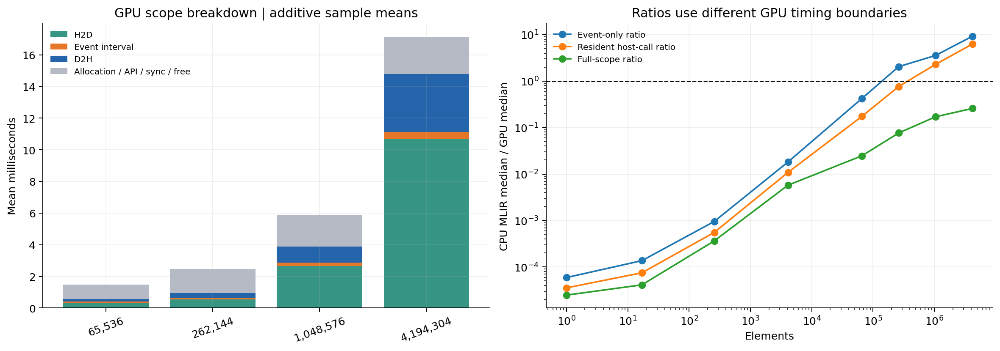
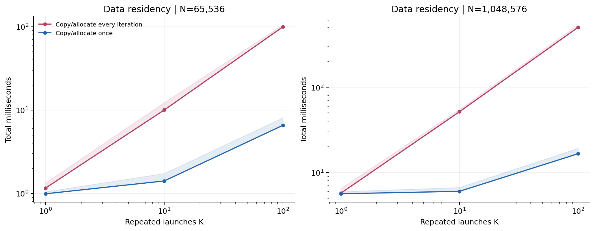
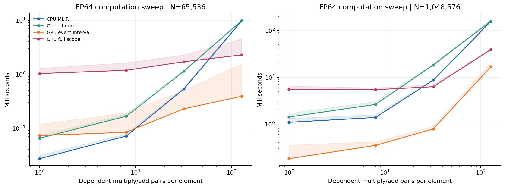
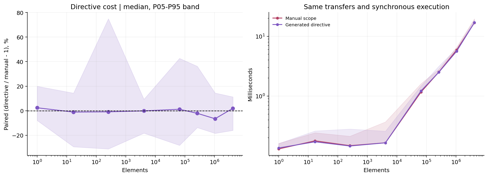
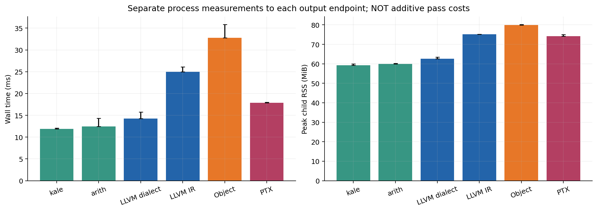

# Kaleidoscope

English | [简体中文](README.zh-CN.md)

[Local benchmarks and charts](#benchmarks-measured-locally)

A small LLVM-based compiler supporting interactive JIT execution and native object file generation.

## Module Structure

```text
include/kaleidoscope/                 Public interfaces; no LLVM implementation headers
  Driver.h                           Compiler entry point
  frontend/                          Token, Lexer, Parser, AST, Operators, Type, SemanticAnalyzer
  support/                           SourceLocation, SourceManager, Diagnostics
src/
  main.cpp                           Calls the driver entry point only
  frontend/                          Lexing, parsing, and semantic/type analysis
  support/                           Cached source lines and located diagnostics
  driver/
    Driver.cpp                       File/REPL sessions and compilation orchestration
    CompilerOptions.h/.cpp           Command-line parsing and option validation
  backend/llvm/
    CodegenContext.h                 Shared internal state and AST visitor declarations
    Expressions.cpp                  Literals, unary/binary expressions, assignment, and calls
    ControlFlow.cpp                  If/for generation and basic-block connections
    Functions.cpp                    Function lookup, prototypes, definitions, and verification
    Module.cpp                       LLVM context/module initialization and codegen diagnostics
    Variables.cpp                    Stack allocation, variable lookup, local scopes, and globals
    Types.cpp                        Scalar LLVM types, constants, conversions, and call ABI
    DebugInfo.h/.cpp                 DWARF types, source locations, scopes, and variables
    Optimizer.h/.cpp                 LLVM optimization pipelines and module verification
    Output.h/.cpp                    Transactional LLVM IR and native object output
    KaleidoscopeJIT.h/.cpp           ORC JIT (original LLVM license retained)
  runtime/
    Runtime.cpp                      Exported printd / putchard functions
examples/                            Kaleidoscope programs and their C++ drivers
tests/                               Frontend isolation and end-to-end regression tests
```

`.h/.cpp` denotes two files. Public headers live under `include/kaleidoscope`;
private headers stay beside their implementations under `src`. Include public
interfaces using their module path, for example `kaleidoscope/frontend/Parser.h`
or `kaleidoscope/support/Diagnostics.h`. The old flat header paths have been removed.

The existing build targets remain unchanged:

- `kaleidoscope_frontend` contains `frontend` and `support`. It can be linked
  independently without LLVM headers or libraries.
- `kaleidoscope_backend` contains the LLVM backend and compiler driver. Its `src`
  include path and LLVM include paths are private.
- `kale` contains `main.cpp` and the runtime functions, which are exported for JIT lookup.

AST nodes own their children. `ConstExprVisitor` supports analysis without rewriting
the tree; semantic analysis updates inferred type annotations. The backend uses
`ExprVisitor`, which only forward-declares `llvm::Value` in the public interface.

The code-generation files implement one shared `CodegenContext`; splitting them
does not introduce a class or header per implementation file. It owns the LLVM
context, module, builder, lowering caches, and JIT. Optimization managers live
within each optimizer invocation. Loop binding lifetime remains with `for` in
`ControlFlow.cpp`, while assignment remains in `Expressions.cpp`; both use variable
storage helpers from `Variables.cpp`. Output belongs to the LLVM backend because
it directly consumes LLVM modules and target machines.

`Compiler` manages component lifetimes and shares the operator-precedence table
between parser and semantic analyzer. The semantic analyzer owns language-level
symbols independently of LLVM. There is no mutable file-scope global state.


## Building

Requirements: a C++17 compiler, CMake 3.20+, and LLVM development packages
(verified with LLVM 21.1.8). Tests are enabled by default and also require Python 3;
disable them with `-DBUILD_TESTING=OFF`.

```bash
cmake -S . -B build -DLLVM_DIR=/usr/lib/llvm-21/lib/cmake/llvm -DCMAKE_BUILD_TYPE=Release
cmake --build build --parallel
ctest --test-dir build --output-on-failure
```

Set `LLVM_DIR` to the `lib/cmake/llvm` directory of your LLVM installation.
The compatibility build script also builds the project and copies the executable
to `kale` in the project root:

```bash
bash compile.sh -DLLVM_DIR=/usr/lib/llvm-21/lib/cmake/llvm
```

## Usage

Run without arguments to enter JIT mode. End the input with Ctrl-D to exit:

```bash
printf 'def twice(x) x*2; twice(21);\n' | ./build/kale
```

Pass a file path to generate `<input-path>.o` alongside the input file,
preserving the original command-line interface:

```bash
./build/kale examples/Fib.kale
c++ examples/Fib_Driver.cpp examples/Fib.kale.o -o build/fib
./build/fib

./build/kale examples/Mandelbrot.kale
c++ examples/Mandelbrot_Driver.cpp examples/Mandelbrot.kale.o -o build/mandelbrot
./build/mandelbrot
```

The language retains support for numbers, functions, `extern`, conditional expressions,
`for`, `var`, assignment, and custom unary/binary operators. Function prototype
parameters are separated by spaces; function call arguments are separated by commas.
Global variables are also supported as described below.

## Global Variables

Global variables are mutable scalar values, defaulting to `double`. Use `global` at the top level;
a declaration must end with a semicolon:

```text
global counter = 10;
global offset = -2.5;
global untouched;
extern global shared;
```

An omitted initializer means the declared type's zero value (`false` for `bool`).
Initializers accept a single literal matching the declared type: decimal `double`
literals such as `.5`, `2.`, and `-0`; `i32` literals such as `-2i32`; or `true`/`false`.
Numeric literals may have an optional `+` or `-` sign.
Arithmetic expressions, function calls, and references to other variables are not
allowed in an initializer; perform those computations through assignments instead.
Malformed numeric literals such as `.` and `1.2.3`, and literals outside the
supported conversion range, produce an error rather than silently accepting a prefix.

Declare a global before using it in a function. `extern global name;` can precede
a later definition in the same file or declare storage supplied by another object
file. An extern declaration never allocates or initializes storage and cannot have
an initializer. Repeated extern declarations are allowed, but a global has only one
definition. Globals and functions share the top-level symbol namespace; conflicts
are diagnosed. `global` is now a reserved keyword.

Parameters, `var` declarations, and `for` variables shadow globals of the same name.
Their initializers can still read the outer binding, and leaving the local scope
restores lookup of the outer variable. Assignments update the nearest visible binding.

Try persistent state in the JIT:

```bash
printf 'global counter=10; def bump(delta) counter=counter+delta; bump(5); counter;\n' | ./build/kale
```

Both expressions evaluate to 15. Global storage persists for the JIT session and
is not removed when temporary top-level expressions are unloaded. A global is
initialized once, not each time a function or expression references it. An extern
global must be supplied before code referencing it is executed; unresolved external
symbols remain a linker/JIT error, just as with external functions.

Compile and run the complete example, which checks global mutation, zero/default
initialization, parameter shadowing, `var` shadowing, and loop-variable shadowing:

```bash
./build/kale -O2 examples/Globals.kale -o build/globals.o
c++ examples/Globals_Driver.cpp build/globals.o -o build/globals
./build/globals
```

Expected output:

```text
counter: 15
local: 98
```

Globals use LLVM's [external-linkage global variables](https://llvm.org/docs/LangRef.html#global-variables).
A C++ consumer can declare a Kaleidoscope global as `extern "C" { extern double counter; }`.
Conversely, a C++ definition such as `extern "C" { double shared = 4; }` can provide
storage for `extern global shared;`. All participating declarations must agree on
the declared type (`double` by default); the compiler does not validate the ABI of a
separately supplied object. See the typed example below for `std::int32_t` and `bool`.

To inspect globals and distinguish them from shadowing locals, build with `-g`:

```bash
./build/kale -g examples/Globals.kale -o build/globals.o
c++ -g -O0 examples/Globals_Driver.cpp build/globals.o -o build/globals
lldb-21 build/globals
```

Inside LLDB:

```text
breakpoint set --file Globals.kale --line 5
run
frame variable delta
target variable counter offset untouched
thread step-out
target variable counter
breakpoint delete --force
breakpoint set --file Globals.kale --line 7
continue
frame variable counter
target variable counter
```

The first breakpoint shows `delta = 5`, global `counter = 10`, `offset = -2`, and
`untouched = 0`. After stepping out, global `counter` is 15. At the second breakpoint,
the parameter `counter` is 1 while the global remains 15. Debug metadata for a global
definition lives in its defining compilation unit; an extern declaration relies on
the defining object for that global's debug information.

## Compilation Options and LLVM IR

```text
kale [-g] [-O0|-O1|-O2|-O3] [--emit-llvm] [-o output] [--] [source.kale]
```

| Option | Behavior |
| --- | --- |
| `-O0` | Skip LLVM IR optimization passes and use unoptimized machine-code generation |
| `-O1`, `-O2`, `-O3` | Use LLVM's corresponding default module pipeline and machine-code optimization level |
| `-g` | Emit DWARF and select `-O0`; combining it with a final positive optimization level is an error |
| `--emit-llvm` | Emit textual LLVM IR instead of an object file; requires an input file |
| `-o path` | Choose the output path; requires an input file |
| `-o -` | Write IR to stdout; requires `--emit-llvm` |
| `--` | End option parsing, allowing an input filename starting with `-` |

The default optimization level is `-O2`, for both file compilation and JIT.
Repeated `-O` options use the last specified level. Without `-o`, file compilation
writes `<input>.o`, or `<input>.ll` with `--emit-llvm`. File compilation is quiet
on success; interactive prompts and expression results remain in JIT mode.

Build an optimized object at a chosen location:

```bash
./build/kale -O2 examples/Fib.kale -o build/fib.o
c++ examples/Fib_Driver.cpp build/fib.o -o build/fib
./build/fib
```

Inspect and validate IR, then compile it through the external LLVM tools:

```bash
./build/kale -O0 --emit-llvm examples/Fib.kale -o build/fib-O0.ll
./build/kale -O2 --emit-llvm examples/Fib.kale -o build/fib-O2.ll
/usr/lib/llvm-21/bin/llvm-as build/fib-O2.ll -o build/fib.bc
/usr/lib/llvm-21/bin/opt -passes=verify -disable-output build/fib.bc
/usr/lib/llvm-21/bin/llc -filetype=obj -relocation-model=pic build/fib.bc -o build/fib-from-ir.o
c++ examples/Fib_Driver.cpp build/fib-from-ir.o -o build/fib-from-ir
./build/fib-from-ir
```

Adjust the LLVM tool paths to your installation. Both executables print 55 for
`fib(10)` and `fibi(10)`. The emitted IR includes the native target triple and data
layout; this CLI does not yet provide cross-compilation or promise arbitrary
retargeting of emitted IR. IR can also be piped without prompts mixed into stdout:

```bash
./build/kale --emit-llvm examples/Fib.kale -o - | /usr/lib/llvm-21/bin/llvm-as -o build/piped.bc
printf 'def twice(x) x*2; twice(21);\n' | ./build/kale -O3
```

Functions and complete modules are verified before use, and modules are verified
again after optimization. No fast-math flags are enabled. Repeated compatible
`extern` declarations reuse a symbol; conflicting signatures, duplicate parameter
names, and repeated definitions are rejected. Failed semantic checks leave operator
precedence unchanged and previously accepted prototypes available to the REPL.

File output is written to a temporary file next to the destination and renamed
only after successful emission and close. Failed compilation leaves any previous
output intact, so always check the compiler's exit status before using an existing
artifact. Output paths that alias the input (including symlinks/hard links),
directories, and special files are rejected. IR verification and these checks do
not sandbox JIT programs or validate arbitrary external-function ABI contracts.

## Source-Level Debugging

Compile a source file with `-g` to emit DWARF debug information. This disables
both IR optimization and machine-code optimization for that compilation, preserving
parameter and local-variable storage for inspection. Normal object compilation and
interactive JIT use the selected optimization level (default `-O2`).

```bash
./build/kale -g examples/Debug.kale
c++ -g -O0 examples/Debug_Driver.cpp examples/Debug.kale.o -o build/debug-demo
lldb-21 build/debug-demo
```

Use `lldb` instead if your installation uses an unversioned executable name.
Inside LLDB:

```text
breakpoint set --file Debug.kale --line 5
run
frame variable x y
thread step-in
frame variable x
thread backtrace
```

At line 5, `x` is 3 and `y` is 4. Stepping into `helper` shows its parameter
`x` as 4. Additional breakpoints at lines 7, 9, and 10 demonstrate the inner
shadowed `y` (13), the loop variables (`y = 8`, `i = 1` on the first iteration),
and the restored outer `y` (11). The program prints `debugdemo(3): 11`.

The generated object contains standard DWARF 4 metadata for source files,
functions, scalar types (`double`, `i32`, `bool`), parameters, global definitions,
`var` declarations, and `for` variables.
Lexical scopes distinguish shadowed names. Source paths are recorded as an absolute
directory plus filename, so keep the source files available to the debugger.
The implementation follows LLVM's [source-level debugging model](https://llvm.org/docs/SourceLevelDebugging.html).
LLDB 21 has been tested end to end; GDB has not been tested in this environment.

`-g` currently requires a source file: JIT source debugging is not implemented.
By default it generates an object file to link with a C++ driver. Combining
`-g --emit-llvm` instead emits unoptimized IR containing debug metadata.
Building the compiler itself with `CMAKE_BUILD_TYPE=Debug` is independent of this option.
Run `./build/kale --help` for command-line usage. `compile.sh` remains unchanged.

## Semantic Analysis and Diagnostics

The compilation pipeline is:

```text
Source -> Lexer -> Parser / AST -> SemanticAnalyzer -> LLVM IR -> Optimization -> JIT / Output
```

Before generating IR, semantic analysis checks variable and function names, argument
counts, duplicate parameters and definitions, conflicting declarations, assignment
destinations, and lexical scopes. Functions can call themselves recursively;
references to later functions require an earlier `extern` declaration. Parameters,
`var` bindings, and loop variables follow the same shadowing rules in JIT and file mode.

Symbols and custom binary-operator precedence are committed only after semantic
analysis and IR generation succeed. An invalid definition does not reserve its name
or replace an accepted declaration. Independent errors within a function body can
be reported together. After a syntax error, the parser skips to a semicolon or the
next `def`, `extern`, or `global` declaration; malformed input may still produce
additional diagnostics before reaching a valid boundary.

Lexer tokens and AST nodes retain one-based source lines and byte columns, with
LF, CRLF, and CR line endings supported. Diagnostics include the source line and a
caret even without `-g`. Tabs count as one byte in locations and expand to eight-column
stops in excerpts. Declaration conflicts also show a note at the earlier declaration.

Reproduce an error after building:

```bash
printf 'def broken(x)\n  x + missing;\n' > build/invalid.kale
./build/kale build/invalid.kale -o build/invalid.o
```

Expected diagnostic (exit status 1; no new object is emitted):

```text
build/invalid.kale:2:7: Error: Unknown variable name 'missing'
    x + missing;
        ^
```

Source excerpts use a two-space display margin. Existing output files are preserved on failure. To verify that a failed definition
does not prevent a later valid definition in the REPL:

```bash
printf 'def twice(x) missing; def twice(x) x*2; twice(21);\n' | ./build/kale
```

This reports the unknown variable and then evaluates the valid call to 42. The
REPL retains its existing behavior of exiting with status 0 at EOF despite recoverable
input errors; file compilation exits with status 1 when diagnostics contain errors.

## Scalar Types and Explicit Conversions

The language supports `double`, signed 32-bit `i32`, and `bool`. A missing type
annotation always means `double`; it does not infer a declaration's type from its
initializer. Existing examples retain their original numerical behavior. The names
`double`, `i32`, `bool`, `true`, and `false` are now reserved words, and `:` introduces
a type annotation.

```text
global count: i32 = 0i32;
global ready: bool = true;
extern global shared: i32;
extern predicate(x: i32): bool;
def add(a: i32 b: i32): i32 a+b;
def choose(flag: bool x: i32 y: i32): i32 if flag then x else y;
def local(x: i32): i32 var next: i32 = x+1i32 in next;
```

Prototype parameters remain space-separated; call arguments are comma-separated.
Numeric literals without a suffix, including `1`, are `double`. Decimal integer
literals use the `i32` suffix, including `0i32` and `-2147483648i32`; fractional or
out-of-range integer literals are rejected. Boolean literals are `true` and `false`.
Local declarations can omit an initializer, giving typed zero/false.

Assignments, initializers, function arguments/results, and both branches of `if`
require matching types. Repeated declarations must match the full signature,
including parameter and return types. There is no implicit numeric conversion:

```text
def increment(x: i32): i32 x+1i32;   # Valid.
def invalid(x: i32): i32 x+1;       # Error: expected i32, got double.
increment(i32(3.9));                 # Explicit conversion; evaluates to 4.
```

| Operation | Behavior |
| --- | --- |
| `+`, `-`, `*` | Matching `double` or `i32` operands; boolean arithmetic is rejected |
| `i32` overflow | Addition, subtraction, multiplication, and unary negation wrap modulo 2^32 |
| `<` on `i32` | Signed comparison returning `bool` |
| `<` on `double` | Preserves the original double 0/1 result, including its unordered NaN comparison behavior |
| Conditions | Accept all three scalar types; zero/false and double NaN are false |
| Unary `+`/`-` on `i32`, `!` on `bool` | Built in; other unary operations still use custom operator declarations |
| `for i: i32 = ...` | Typed initializer and step; omitted step is typed one; boolean loop variables are rejected |
| Loop result | Remains double zero, regardless of loop-variable type |

Custom operators can also declare typed parameters/results, but are not overloaded
by type. Built-in operations take precedence over custom operator definitions.

Explicit conversions take exactly one argument:

| Conversion | Behavior |
| --- | --- |
| `double(x)` | Signed integer to double; boolean to 0.0/1.0 |
| `i32(x)` | Boolean to 0/1; double truncates toward zero and saturates to the i32 range; NaN becomes 0 |
| `bool(x)` | Same nonzero test as conditions, including false for double NaN |
| Same-type conversion | Leaves the value unchanged |

Typed values work in both JIT and object mode. The REPL converts the final result
to double for its existing `Evaluated to ...` display, so boolean results display
as 0 or 1. Function bodies and stored variables retain their actual types.

```bash
printf 'def add(a: i32 b: i32): i32 a+b; add(20i32,22i32); !false;\n' | ./build/kale
./build/kale -O2 examples/Types.kale -o build/types.o
c++ examples/Types_Driver.cpp build/types.o -o build/types
./build/types
```

The REPL prints results 42 and 1; the executable prints `Typed scalars: passed`.
The driver checks recursion, globals, boolean arguments/results, conversions,
integer overflow, and typed local/loop bindings. Use `std::int32_t` for `i32` and
C++ `bool` for `bool` in `extern "C"` declarations. Native interoperability has
been tested on x86-64 Linux; arbitrary external ABI compatibility is not inferred.

Debug typed parameters, locals, and globals:

```bash
./build/kale -g examples/Types.kale -o build/types.o
c++ -g -O0 examples/Types_Driver.cpp build/types.o -o build/types
lldb-21 build/types
```

```text
breakpoint set --file Types.kale --line 14
run
frame variable x flag y active
target variable counter enabled
```

At the first stop, `x = 4`, `flag = true`, `y = 5`, `active = true`, global
`counter = 3`, and `enabled = true`. LLDB may display `i32` as its C type alias `int`.
DWARF records a signed 32-bit integer and a boolean type alongside double metadata.

The frontend's `Type` and `FunctionType` remain independent of LLVM. Symbols carry
value types or full function signatures. `ExprAST::type()` is `Unknown` before
analysis, a scalar type after successful analysis, or `Error` after a failed
expression. Error types suppress redundant diagnostics; annotations are recomputed
on reanalysis. The backend maps checked types to LLVM `double`, `i32`, and `i1`
and uses a double-returning wrapper for top-level expressions.

```bash
cmake --build build --parallel
ctest --test-dir build -R 'type_analysis|typed_language|typed_debugger' --output-on-failure
ctest --test-dir build --output-on-failure
```

## Validation and Maintenance

- `frontend_sessions` links only the frontend library and verifies state isolation
  across multiple Lexer, Parser, and Diagnostics instances, plus source positions
  and positioned syntax errors.
- `compiler_regression` covers operator precedence, function calls, conditionals,
  loops, variables, custom operators, runtime symbols, error recovery, and rejection
  of invalid source files. It also compiles, links, and runs the Fib and Mandelbrot examples.
- `compiler_debug_regression` runs the same object-file checks with `-g`.
- `debug_info` uses `llvm-dwarfdump` to verify DWARF and checks diagnostics and CLI
  behavior. It also confirms ordinary compilation omits debug metadata.
- `debugger_integration` uses LLDB to verify source breakpoints, step-in, backtraces,
  parameters, local variables, shadowing, and loop variables. It requires permission
  to launch and trace a child process. CMake enables these last two tests when the
  corresponding tools are found and reports when they are unavailable.
- `compiler_pipeline` checks all four optimization levels in JIT and object mode,
  validates IR with `llvm-as`/`opt`, rebuilds it with `llc`, and tests floating-point
  behavior, declaration recovery, and output protection. CMake enables it when
  those three LLVM tools are available.
- `global_variables` checks globals at all optimization levels and with `-g`,
  including persistent JIT state, forward declarations, cross-file linkage,
  C++ interoperability, shadowing, invalid declarations, and preserved output on errors.
  It verifies global IR/DWARF when the corresponding LLVM tools are available.
- `global_debugger` uses LLDB to inspect global values before and after assignment
  and distinguish a shadowing parameter from the global. It is enabled when LLDB
  and `llvm-dwarfdump` are available.
- `semantic_analysis` links only the frontend and verifies name resolution, recursion,
  signatures, scopes, custom operators, independent sessions, and symbol commits.
- `type_analysis` links only the frontend and checks signatures, every expression kind,
  error propagation through bindings, and recomputation after an invalid name is resolved.
- `diagnostics_recovery` checks multiple errors, source excerpts, tab-aligned carets,
  declaration notes, line endings, EOF diagnostics, REPL recovery, and output preservation.
- `typed_language` checks all optimization levels, strict type errors, conversion boundaries,
  integer overflow, typed operators, JIT state, native C++/cross-file ABI, and available IR/DWARF tools.
- `typed_debugger` checks typed parameters, locals, and globals in LLDB when LLDB and
  `llvm-dwarfdump` are available.
- `.clang-format` standardizes C++ formatting. Add syntax in Token/Parser/AST,
  add semantic rules in SemanticAnalyzer and IR generation in the backend visitor, and keep command-line
  workflows in Driver to avoid accumulating logic in main again.

Unannotated programs retain double semantics and the existing REPL output format,
except that the new type and boolean keywords are reserved.
The optional MLIR backend uses ConstExprVisitor with its own MLIR value state;
it does not reuse the LLVM-returning ExprVisitor interface.

## Chapter 10 Extension Roadmap

The compiler-workflow improvements apply the [Chapter 10](https://llvm.org/docs/tutorial/MyFirstLanguageFrontend/LangImpl10.html)
discussion of IR, optimization, and language-level checks to the compiler workflow.
Optimization uses LLVM's [new pass manager](https://llvm.org/docs/NewPassManager.html)
and standard pipelines; no language-specific optimization pass is claimed here.

Global variables are implemented, including native linkage and debug information.
Explicit scalar types and conversions are implemented for native compilation targets.
The MLIR path additionally supports borrowed one-dimensional arrays and a synchronous
CPU/CUDA teaching runtime. General aggregate/structure types, heap allocation/GC,
and exceptions remain separate work. Aggregate layout and memory semantics should be
designed before adding `sizeof`, field offsets, or GC.

## MLIR Execution and CUDA Exercise

An optional MLIR backend now supports scalar functions, calls, conditionals,
post-tested loops, local mutation, and borrowed one-dimensional double arrays.
It lowers Kale operations through standard MLIR conversions to LLVM dialect,
exports LLVM IR/native objects, and generates an explicit element-map PTX kernel.
The CPU/CUDA teaching runtime manages mappings, copies, launch, synchronization,
and cleanup. This is not an OpenACC implementation or a general loop parallelizer.

Start with the [Dialect Conversion guide](docs/MLIRStage2.md), then follow the
[execution, array ABI, CUDA build, and test guide](docs/MLIRExecutionAndGPU.md).
The source example is examples/Vector.kale; kale-vector-demo runs lengths
0, 1, 17, 257, and 100003 and prints copy/kernel/total timings.

Enable KALEIDOSCOPE_ENABLE_MLIR with matching LLVM/MLIR packages (tested: 23.1.6).
Enable KALEIDOSCOPE_ENABLE_CUDA for the CUDA Driver API backend (tested: Toolkit
12.8 and RTX 3080 Ti Laptop GPU, sm_86). Both options default to OFF.
The existing LLVM-only kale executable remains available and rejects array
parameters with a diagnostic. The new array keyword is reserved in both modes;
array values are currently limited to borrowed parameters in the MLIR path.

## OpenACC-style Teaching Directives

The restricted #acc parallel loop copyin(x,y) copyout(out) directive now
validates an independent element-map loop and generates a kacc_<function> host
entry that automatically manages CPU/CUDA data transfers, execution and cleanup.
See [the teaching-subset guide](docs/OpenACCTeaching.md) and examples/AccVector.kale.
This is explicitly not standard OpenACC, Flang support, or the upstream acc dialect.

<!-- BENCHMARKS:START -->
## Benchmarks: measured locally

**2026-11-14 · 12th Gen Intel(R) Core(TM) i7-12700H / NVIDIA GeForce RTX 3080 Ti Laptop GPU · LLVM 23.1.6 · CUDA 12.8.**
The suite covers compilation, scalar/vector execution, GPU event and end-to-end timing,
data residency, FP64 computation density, and teaching-directive overhead.
It retains 2766 runtime observations (including first-use records) and 84 compiler samples; no slow outliers are discarded.

| Representative result (median) | Measured |
| --- | ---: |
| 500 functions: original LLVM backend compilation | 376.215 ms |
| 500 functions: MLIR backend compilation | 637.649 ms (1.69×) |
| 1,048,576 elements: direct CPU MLIR execution | 1.006 ms |
| Same size: resident GPU event interval | 0.282 ms |
| Same size: resident GPU synchronous host call | 0.439 ms |
| Same size: complete GPU data scope | 5.887 ms |
| Same size, 128 multiply/add pairs: CPU / complete GPU scope | 157.223 / 39.320 ms (4.00×) |
| Same size, 100 launches: fresh scopes / one resident scope | 504.382 / 16.629 ms (30.33×) |

**In this local run, GPU computation is shorter, but full transfers make the simple FP64 vector operation slower end to end.**
Event-only ratios are not application speedups. Device-data reuse substantially reduces repeated allocation/copy cost.
Directive-versus-manual differences are noisy: paired P05–P95 ranges are retained rather than claiming a fixed overhead percentage.

### Methodology

- Identical FP64 inputs and arithmetic; vector samples verify all outputs and a host-side tail guard outside timing. Scalar backend parity is checked before timing.
- Runtime configurations: 5 warmups and 21 samples. Residency: 2 warmups and 7 samples. Compilation: 1 warmup and 7 samples.
- CPU direct calls are batched (1000 calls for N ≤ 257). Scalar ns/call includes call, loop and checksum accumulation; it is not instruction latency.
- Single-threaded measurement processes are pinned to WSL logical CPU 0. C++ baselines use Clang 23 -O2 with FP contraction disabled, without -march=native or fast-math.
- C++ checked retains array length checks; unchecked has weaker safety semantics. The CPU simulation includes extra copies and is not the GPU speedup baseline.
- CUDA uses synchronous APIs, pageable host memory and 256-thread blocks. Resident event intervals and synchronous host calls are recorded separately; first-use observations are excluded from steady-state summaries.
- Most plots show medians with bands/error bars up to P95. Cost decomposition uses means of the same samples to preserve additivity.
- Effective bandwidth uses logical traffic 24N/time. Repeated data can be cached; this is not a measurement of physical DRAM bandwidth.
- Computation density is 1/8/32/128 dependent multiply/add pairs; saved PTX retains the corresponding mul/add counts with no FMA or arithmetic elimination.
- Compiler stages are cumulative output endpoints measured in separate processes, not additive individual-pass costs.
- Residency consumes only the final result in both variants; it does not model an application that needs every intermediate result on the host.
- Frequencies are not locked. WSL scheduling, temperature, display activity and background load affect results. These are not universal hardware rankings or OpenACC V&V results.

### Compilation time, memory and object size



### Scalar execution



### Vector length and effective traffic rate



### GPU cost breakdown and timing boundaries



### Device data residency



### Increasing FP64 computation



### Teaching-directive overhead



### Compiler output endpoints



### Raw records and reproduction

[Runtime samples](benchmarks/results/2026-11-14/runtime.csv) · [Compiler samples](benchmarks/results/2026-11-14/compile.csv) ·
[Runtime summary](benchmarks/results/2026-11-14/runtime_summary.csv) · [Compiler summary](benchmarks/results/2026-11-14/compile_summary.csv) ·
[Environment, commands and source hashes](benchmarks/results/2026-11-14/environment.json) · [Generated sources](benchmarks/results/2026-11-14/sources/) · [LLVM IR/PTX](benchmarks/results/2026-11-14/ir/)

Residency uses the lower-level runtime; current teaching directives still allocate and transfer on every call.
Charts are saved as PNG and SVG. The commands require an already configured MLIR/CUDA build
and Python matplotlib/numpy. Choose a fresh --out directory to preserve existing records.

[Measurement log](benchmarks/results/2026-11-14/logs/benchmark-run.log) · [Regression test log](benchmarks/results/2026-11-14/logs/regression-tests.log)

```bash
python3 benchmarks/run.py --out benchmarks/results/my-run
python3 benchmarks/plot.py benchmarks/results/my-run --update-readme
```

<!-- BENCHMARKS:END -->
