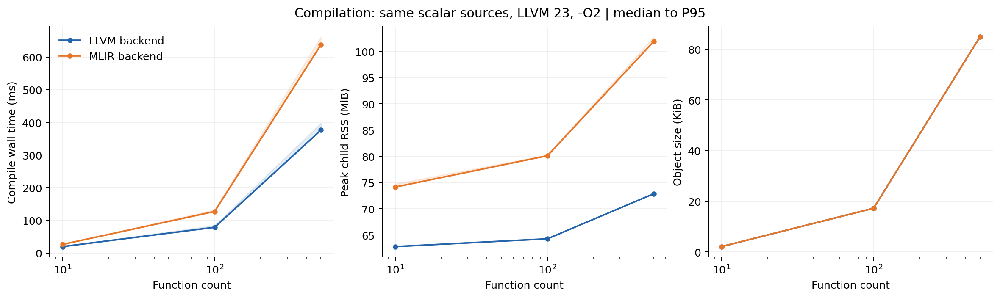
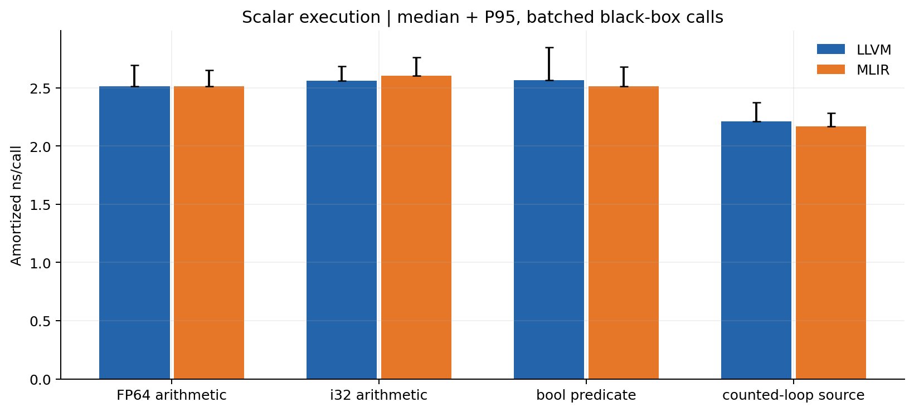
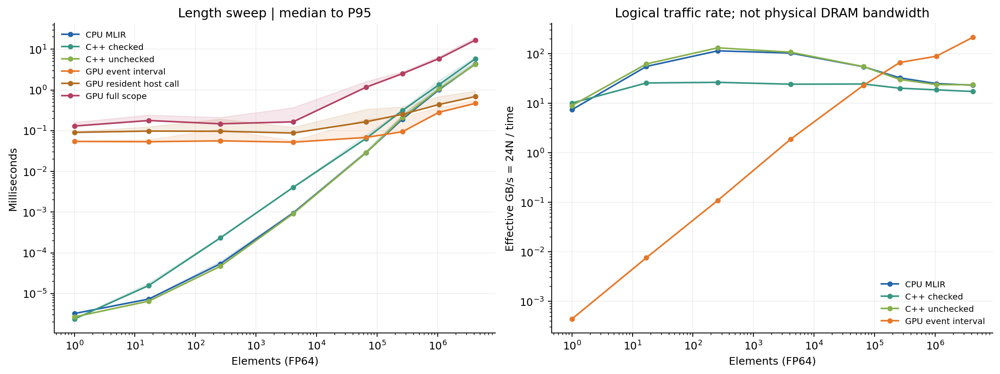
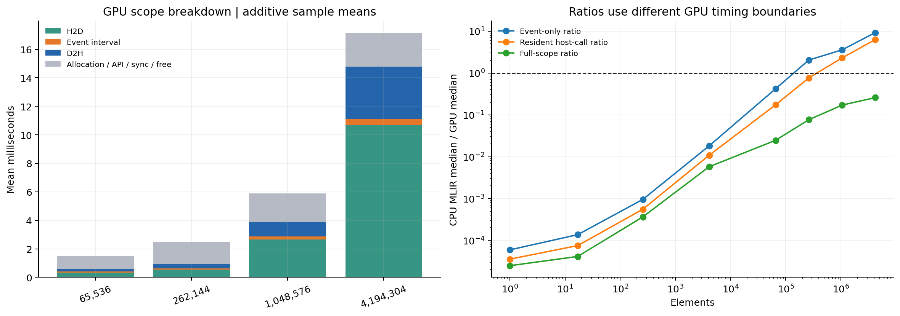
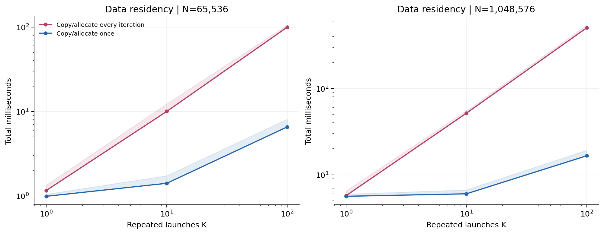
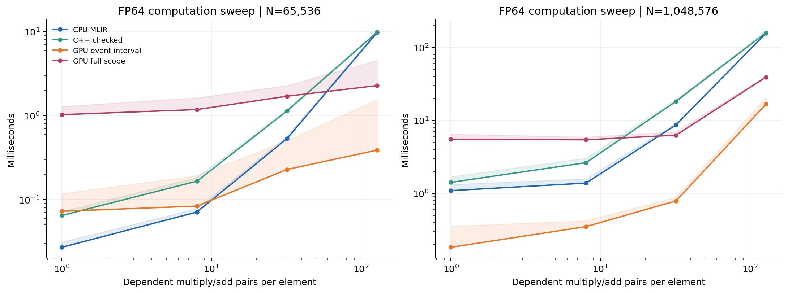
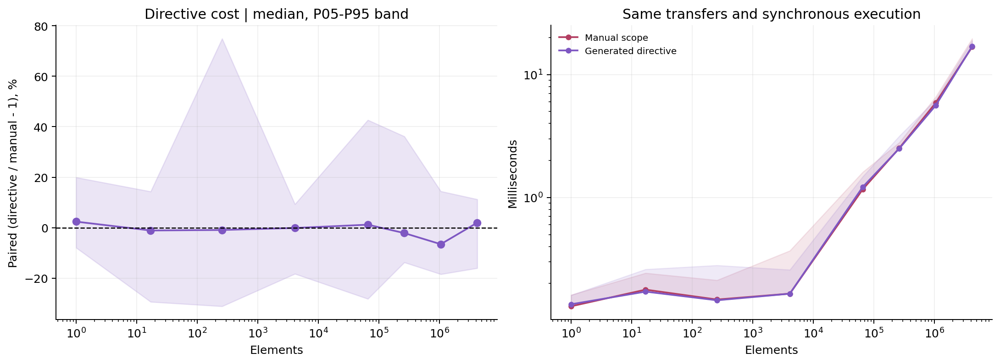
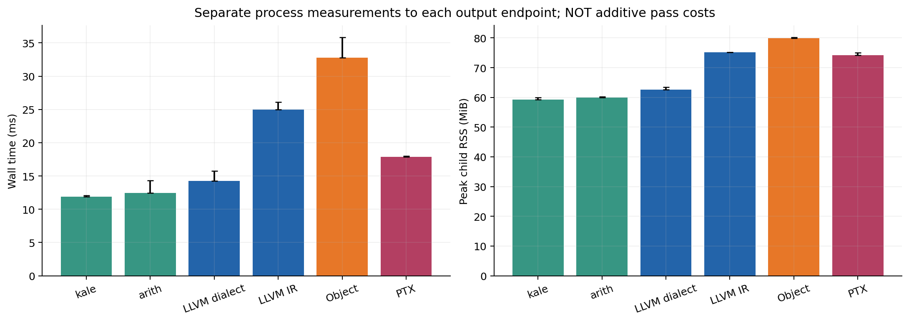

# Kaleidoscope

[English](README.md) | 简体中文

一个教学编译器，支持词法/语法与类型检查、LLVM JIT、原生目标文件、MLIR Dialect Conversion、一维数组及 CUDA 执行。
本项目包含受限的 OpenACC 风格教学指令，不是 Flang 或标准 OpenACC 实现。

[本地 Benchmark 与图表](#benchmark本地实测) · [Dialect Conversion](docs/MLIRStage2.md) ·
[MLIR/数组/CUDA](docs/MLIRExecutionAndGPU.md) · [教学指令](docs/OpenACCTeaching.md)

## 模块与编译路径

```text
include/kaleidoscope/
  frontend/       Token、Lexer、Parser、AST、Type、SemanticAnalyzer
  support/        源位置、源文件缓存、诊断
  runtime/        数组 ABI、设备运行时接口
src/
  main.cpp        只调用驱动入口
  frontend/       独立于 LLVM 的词法、语法和语义检查
  support/        定位诊断与源码片段
  driver/         文件/REPL 会话、命令行、编译组织
  backend/llvm/   表达式、控制流、变量、函数、类型、优化、输出、DWARF、ORC JIT
  backend/mlir/   Dialect、AST 生成 IR、转换 Pass、LLVM 导出、教学指令
  runtime/        printd/putchard、CPU/CUDA 同步运行时
  tools/          MLIR 工具入口
examples/         源程序及 C++ 驱动
tests/            前端单测、编译执行、调试器、MLIR 和 GPU 验收
benchmarks/       性能驱动、测量/绘图脚本及原始结果
```

公共头文件使用模块路径，例如 `kaleidoscope/frontend/Parser.h`。
`kaleidoscope_frontend` 可以独立链接，不依赖 LLVM 头文件或库。
`kaleidoscope_backend` 管理原 LLVM 后端与驱动，`kale` 提供命令行和 JIT 运行时符号。
AST 拥有子节点；语义分析维护独立符号表与类型注解。
原 LLVM 后端使用 `ExprVisitor`；MLIR 后端通过 `ConstExprVisitor` 遍历 AST，
不需要把 MLIR value 塞入原有 `llvm::Value*` 返回类型。

```text
源码 → Lexer → Parser / AST → SemanticAnalyzer
  ├─ LLVM IR → 优化 → ORC JIT / 原生目标文件
  └─ kale + arith + func + scf + memref + cf
       → 标准 dialect → LLVM dialect → LLVM IR → 原生目标文件 / PTX
```

LLVM dialect 仍属于 MLIR；经过 translation 后才得到 LLVM IR。
标准转换复用 MLIR 的规则及 LLVMTypeConverter，而非手写全部 arith/func 到 LLVM 的模式。

## 构建

要求 C++17、CMake 3.20+、LLVM 开发包；测试默认开启，需要 Python 3。
原 LLVM 路径已验证 LLVM 21.1.8：

```bash
cmake -S . -B build -DLLVM_DIR=/usr/lib/llvm-21/lib/cmake/llvm -DCMAKE_BUILD_TYPE=Release
cmake --build build --parallel
ctest --test-dir build --output-on-failure
```

按安装位置调整 LLVM_DIR。关闭测试可用 `-DBUILD_TESTING=OFF`。
兼容脚本 `bash compile.sh -DLLVM_DIR=/usr/lib/llvm-21/lib/cmake/llvm`
还会把可执行文件复制到项目根目录的 kale。

MLIR 与 CUDA 构建必须使用匹配的 LLVM/MLIR 版本；本机已验证 23.1.6 与 CUDA 12.8：

```bash
cmake -S . -B build/mlir \
  -DLLVM_DIR=/usr/lib/llvm-23/lib/cmake/llvm \
  -DMLIR_DIR=/usr/lib/llvm-23/lib/cmake/mlir \
  -DKALEIDOSCOPE_ENABLE_MLIR=ON \
  -DKALEIDOSCOPE_ENABLE_CUDA=ON \
  -DCUDAToolkit_ROOT=/usr/local/cuda-12.8 \
  -DCMAKE_BUILD_TYPE=Release
cmake --build build/mlir -j4
ctest --test-dir build/mlir --output-on-failure
```

MLIR/CUDA 选项默认 OFF；没有 CUDA 时可关闭 CUDA 选项，保留 MLIR 与 CPU 模拟。
GPU 测试在没有设备时显示 Skipped，不能当作 GPU 通过。
当前 GPU 目标是 sm_86，已实际运行于 RTX 3080 Ti **Laptop GPU**。

## 原 LLVM 后端用法

不带文件参数进入 REPL，Ctrl-D 退出；传入文件生成目标文件：

```bash
printf 'def twice(x) x*2; twice(21);\n' | ./build/kale
./build/kale examples/Fib.kale
c++ examples/Fib_Driver.cpp examples/Fib.kale.o -o build/fib
./build/fib
```

Fib 示例的 fib(10) 与 fibi(10) 均为 55。
函数原型的参数用空格分隔，调用参数用逗号分隔。
支持 extern、函数、if、for、var、赋值、自定义一元/二元运算符及全局变量。

```text
kale [-g] [-O0|-O1|-O2|-O3] [--emit-llvm] [-o output] [--] [source.kale]
```

| 选项 | 行为 |
| --- | --- |
| -O0 | 不运行 LLVM IR 优化，使用未优化机器码生成 |
| -O1/-O2/-O3 | 使用相应的 LLVM 标准优化流水线，默认 -O2 |
| -g | 输出 DWARF 并选择 -O0；最终优化等级为正时与 -g 冲突 |
| --emit-llvm | 文件模式输出文本 LLVM IR |
| -o 路径 | 指定输出；配合 --emit-llvm 可用 -o - 输出到 stdout |
| -- | 结束选项解析，允许文件名以减号开头 |

重复 -O 采用最后指定值。默认输出为源文件路径加 .o 或 .ll。
-g 需要源文件，尚不支持 JIT 源级调试。编译器本身的 Debug 构建与语言的 -g 无关。

```bash
./build/kale -O2 --emit-llvm examples/Fib.kale -o build/fib.ll
/usr/lib/llvm-21/bin/llvm-as build/fib.ll -o build/fib.bc
/usr/lib/llvm-21/bin/opt -passes=verify -disable-output build/fib.bc
/usr/lib/llvm-21/bin/llc -filetype=obj -relocation-model=pic build/fib.bc -o build/fib-from-ir.o
```

输出带本机 target triple/data layout；原后端命令行不承诺任意跨目标编译。
函数与模块在使用前、模块优化后均验证，不启用 fast-math。
文件先写临时文件，成功后原子替换；失败保留已有输出。
拒绝输出与输入相同、软/硬链接别名、目录和特殊文件。使用产物前仍须检查退出码。

## 标量、作用域与转换

支持 double、带符号 i32、bool。省略注解表示 double，不从初始化值推断声明类型。
普通数字字面量是 double；i32 使用 0i32、-2i32 等后缀。

```text
def add(a: i32 b: i32): i32 a+b;
def choose(flag: bool x: i32 y: i32): i32 if flag then x else y;
def local(x: i32): i32 var next: i32 = x+1i32 in next;
```

赋值、初始化、实参/返回值以及 if 两分支要求类型匹配，没有隐式数值转换。
double/i32/bool/true/false/array 是保留字。
自定义运算符可声明类型，但不支持按类型重载，内建操作优先。

| 操作 | 语义 |
| --- | --- |
| +、-、* | 两侧必须同为 double 或 i32，拒绝 bool 算术 |
| i32 溢出 | 加减乘与负号按 2^32 回绕 |
| i32 的 < | 有符号比较，返回 bool |
| double 的 < | 保留原 unordered 比较，返回 double 0/1 |
| 条件 | 接受标量；零、false 和 double NaN 为假 |
| double(x) | 有符号整数转 double，bool 转 0.0/1.0 |
| i32(x) | bool 转 0/1；double 向零截断并饱和，NaN 转 0 |
| bool(x) | 与条件相同的非零检查 |
| 同类型转换 | 保持原值 |

例如 i32(3.9) 为 3；add(i32(3.9),1i32) 为 4。
C++ ABI 使用 double、std::int32_t 和 bool，已验证 x86-64 Linux。
REPL 只在显示最终表达式时转成 double，变量和函数保留其实际类型。

for 是**后测试循环**：body → 求 step → 求结束条件 → 读取当前循环变量并加 step → 决定是否继续。
body 至少执行一次，返回 double 零，不能直接当成前测试 scf.for。
MLIR 使用 scf.while 保留上述顺序；if 使用有结果的 scf.if。
可变标量通过函数入口的 rank-0 memref.alloca 保存，避免循环内持续增加栈分配。

参数、var 和循环变量遮蔽外层绑定，初始化可读取外层值，退出作用域恢复名称查找。
赋值更新最近的绑定。普通递归可用，调用后定义的函数需要先 extern。

## 全局变量

原 LLVM 后端支持全局标量；MLIR 路径暂不支持全局变量和自定义运算符。

```text
global counter = 10;
global count: i32 = 0i32;
global ready: bool = true;
extern global shared: i32;
def bump(delta) counter=counter+delta;
```

声明必须以分号结束，省略初始化为对应类型的零/false。
初始化仅接受类型匹配的单个字面量及数值正负号，不接受表达式、函数调用或变量引用。
extern 不分配存储，不能初始化；可重复兼容声明，但定义只能出现一次。
全局变量与函数共享顶层名称空间。使用前须声明，参数/局部变量可遮蔽全局。

JIT 全局存储在会话中持续存在，临时顶层表达式卸载不会删除它。
跨文件使用 extern "C" 提供类型一致的 C++ 定义；编译器不推断外部对象的 ABI。
未解析外部符号仍为链接/JIT 错误。

```bash
./build/kale -O2 examples/Globals.kale -o build/globals.o
c++ examples/Globals_Driver.cpp build/globals.o -o build/globals
./build/globals
```

输出 counter: 15 与 local: 98。类型完整示例见 examples/Types.kale 和对应驱动。

## 诊断与调试

语义检查覆盖未定义名称、参数数量、冲突签名、重复参数/定义、赋值目标、类型及作用域。
只有语义与 IR 生成成功后才提交符号和运算符优先级，失败定义不污染后续 REPL。
诊断包含行列、源码片段、光标及冲突声明位置；支持 LF/CRLF/CR。
列号按字节计，诊断显示中的 tab 展开到八列边界。

```bash
printf 'def broken(x)\n  x + missing;\n' > build/invalid.kale
./build/kale build/invalid.kale -o build/invalid.o
```

文件编译错误返回 1；REPL 可恢复的输入错误后继续，EOF 时仍返回 0。
语法错误恢复到分号或下一个 def/extern/global，畸形输入可能产生后续诊断。

```bash
./build/kale -g examples/Debug.kale
c++ -g -O0 examples/Debug_Driver.cpp examples/Debug.kale.o -o build/debug-demo
lldb-21 build/debug-demo
```

在 LLDB 中可使用 breakpoint set --file Debug.kale --line 5、run、
frame variable x y、thread step-in、thread backtrace。
DWARF 4 覆盖源文件、函数、标量类型、参数、全局定义、局部变量及词法作用域。
源路径包含绝对目录，调试时须保留源码。LLDB 21 已验证，GDB 未在本环境验收。
-g --emit-llvm 可查看带调试元数据的未优化 IR。

## MLIR、数组与 CUDA

```bash
build/mlir/src/backend/mlir/kale-mlir examples/Vector.kale
build/mlir/src/backend/mlir/kale-mlir --lower-to-arith examples/Vector.kale
build/mlir/src/backend/mlir/kale-mlir --emit-llvm-dialect examples/Vector.kale
build/mlir/src/backend/mlir/kale-mlir --emit-llvm examples/Vector.kale -o build/mlir/vector.ll
build/mlir/src/backend/mlir/kale-mlir --emit-object examples/Vector.kale -o build/mlir/vector.o
build/mlir/src/backend/mlir/kale-mlir --emit-ptx --gpu-map element examples/Vector.kale -o build/mlir/vector.ptx
build/mlir/src/runtime/kale-vector-demo cpu
build/mlir/src/runtime/kale-vector-demo cuda build/mlir/src/runtime/vector.ptx
```

array 是借用的连续一维 double 参数，映射为 memref<?xf64>。
load(array,i32) 读取，store(array,i32,double) 写入并返回写入值，size(array) 返回 i32。
访问有边界检查；不支持数组返回、局部分配、全局数组、切片或动态秩。
原 LLVM 后端拒绝数组参数。

C++ 使用 include/kaleidoscope/runtime/ArrayABI.h 的 KaleArray 和
生成的 _mlir_ciface_ 包装器；描述符包含两个指针、i64 offset、sizes[1]、strides[1]。
调用者持有存储，要求 offset=0、stride=1、0≤length≤INT32_MAX；
索引检查不验证伪造指针。ABI 细节与示例见 [执行指南](docs/MLIRExecutionAndGPU.md)。

GPU 编译从源码 element(x,y,a) 生成一维 map kernel，算术不是运行时硬编码。
256 线程一块，尾部检查，n=0 不启动 kernel；当前是显式 map，不是任意循环自动并行化。
CPU 模拟后端用独立缓冲区模拟迁移；CUDA 后端真实加载 PTX、分配设备内存并执行。
运行时接口依次管理 create、enter、copyin、launch、wait、copyout、exit、destroy，
返回状态码并提供 krt_error。同步、单设备，暂不支持异步队列或嵌套引用计数。

## OpenACC 风格教学指令

```text
def element(x y a) a*x+y;

#acc parallel loop copyin(x,y) copyout(out)
def vector(x: array y: array out: array a)
  if 0i32 < size(x) then
    for i: i32 = 0i32, i < size(x)-1i32 in
      store(out,i,element(load(x,i),load(y,i),a))
  else 0;
```

指令必须位于函数之前，当前只接受上述子句组合和受限循环形状。
element 只接受纯 double 加减乘表达式。未知子句或不满足独立 map 形状直接报错，
不忽略指令，也不静默退回串行。

编译器记录 kale.acc_plan 元数据，生成 kacc_vector 宿主入口，并自动推导 PTX 的 element。
调用者负责建立 session、加载同一源码生成的 PTX、最终销毁 session；
生成入口自动管理本次的数据迁移、执行与清理。输入/输出须为连续、等长、不重叠的数组。
每次指令调用创建独立数据区域，不自动跨调用驻留。
保留 _mlir_ciface_vector 作为原生串行参考。

```bash
build/mlir/src/runtime/kale-acc-demo cpu
build/mlir/src/runtime/kale-acc-demo cuda build/mlir/src/runtime/acc-vector.ptx
ctest --test-dir build/mlir -R '^acc_' --output-on-failure
```

具体解析、语义限制、ABI 与错误测试见 [教学子集指南](docs/OpenACCTeaching.md)。
这里不实现 Fortran/Flang、FIR/HLFIR、上游 acc dialect、OpenACC ABI 或 OpenACC V&V 兼容性。

## 测试与维护

测试覆盖以下层次：

- 独立前端：会话隔离、名称解析、类型、源码位置、多错误诊断及恢复。
- 原 LLVM 路径：JIT/目标文件、多优化等级、整数回绕、NaN/饱和转换、全局变量、ABI、输出保护。
- 调试：DWARF 验证，LLDB 断点、单步、回溯、遮蔽变量、全局与类型检查；相关工具存在时启用。
- MLIR：操作验证、SSA 替换、ConversionTarget 合法性、缺失 Pattern 失败、LLVM translation 失败。
- 执行：双后端标量一致性、数组边界、循环副作用、真实 CUDA map、零/单元素/非整齐长度。
- 运行时与教学指令：映射、生命周期、错误清理、别名与描述符错误、解析与并行形状拒绝。

完整 MLIR/CUDA 配置本地 20/20 通过，GPU 项目实际执行；原 LLVM 21 独立配置 14/14 通过。
性能测量单独运行，不把时间阈值作为正确性测试的通过条件。

添加语法时同步更新 Token/Parser/AST、语义规则和相应后端；
保持驱动逻辑在 Driver，公共前端不依赖 LLVM。
.clang-format 提供 C++ 格式规范。更完整的测试条目可参见 [英文 README](README.md#validation-and-maintenance)。

## 后续方向

已完成标量类型、全局变量、MLIR lowering、借用一维数组、同步设备运行时及教学指令。
一般聚合类型、结构体布局、堆分配/GC、异常、归约、异步执行仍属后续工作。
若面向真实 Flang/OpenACC 开发，可进一步跟踪一个实际子句的语义检查、acc/FIR 表示与 lowering。
本项目的运行时/转换经验可以迁移，但不能替代真实 Flang 和 OpenACC V&V 验证。

<!-- BENCHMARKS:START -->
## Benchmark：本地实测

**2026-11-14 · 12th Gen Intel(R) Core(TM) i7-12700H / NVIDIA GeForce RTX 3080 Ti Laptop GPU · LLVM 23.1.6 · CUDA 12.8。**
本次完成编译、标量、向量、GPU 内核/端到端、数据驻留、计算量及教学指令开销测试。
保留 2766 条运行时观测（含首次使用记录）和 84 条编译样本；不删除异常慢样本。

| 代表性结果（中位数） | 实测 |
| --- | ---: |
| 500 个函数，原 LLVM 后端编译 | 376.215 ms |
| 500 个函数，MLIR 后端编译 | 637.649 ms（1.69×） |
| 1,048,576 元素，CPU MLIR 直接执行 | 1.006 ms |
| 同规模，GPU 驻留数据的 event 区间 | 0.282 ms |
| 同规模，GPU 驻留数据的同步宿主调用 | 0.439 ms |
| 同规模，GPU 完整数据区域 | 5.887 ms |
| 同规模，每元素 128 对乘加：CPU / GPU 完整区域 | 157.223 / 39.320 ms（4.00×） |
| 同规模重复 100 次：每次迁移 / 驻留一次 | 504.382 / 16.629 ms（30.33×） |

**结论：本机这次测量中，GPU 的计算阶段更短，但简单 FP64 向量运算的完整迁移流程更慢。**
不能把 event-only 的比值当作端到端加速比。复用设备数据显著降低了重复分配和传输成本。
教学指令相对手写调用的差异存在噪声，图中保留配对样本的 P05–P95，不宣称固定百分比开销。

### 测量口径

- CPU/GPU 使用相同 FP64 输入及运算；向量每个样本后检查全部结果和主机尾部哨兵，检查不计时。标量计时前验证双后端一致性。
- 运行时每项预热 5 次、测量 21 次；驻留实验预热 2 次、每项 7 次；编译每项预热 1 次、测量 7 次。
- CPU 直接执行使用批量计时；小于等于 257 元素批量 1000 次。标量报告包含调用、循环和校验和累加成本，不能解释为单条运算延迟。
- 单线程测量进程固定到 WSL 逻辑 CPU 0；C++ 基线为 Clang 23 -O2、关闭 FP contraction，未用 -march=native 或 fast-math。
- C++ checked 保留数组长度检查；unchecked 是较弱安全语义的参考。CPU 模拟运行时含额外复制，不作为 GPU 加速比基线。
- CUDA 使用同步 API、pageable 主机内存、256 线程块。驻留 event 时间与同步宿主调用时间分别保存；进程首次使用单独记录且不混入稳定样本，不代表硬件/系统缓存冷启动。
- 图中通常是中位数，淡色带/误差线延伸至 P95；阶段分解使用同一组样本的均值以保证可加和。
- 有效带宽按逻辑流量 24N/time 计算；重复访问可能命中缓存，不能据此称为实际 DRAM 带宽。
- 计算量采用 1/8/32/128 对有依赖的乘加；保存的 PTX 分别保留相同数量的 mul/add，未融合为 FMA、未折叠掉。
- 各编译输出阶段都是独立进程的累计端点耗时，不能相加或直接相减推断单个 Pass 成本。
- 数据驻留实验中只有最后一次结果被消费，两方案可观察结果相同；它不代表每轮都必须回传结果的工作负载。
- 未锁定 CPU/GPU 频率；WSL、温度、显示负载和后台程序会影响结果。本报告不是通用硬件排名或 OpenACC V&V 性能结论。

### 编译耗时、内存与目标文件大小



### 标量执行



### 数组长度与有效数据吞吐



### GPU 阶段占比与计时边界



### 设备数据驻留



### 增加 FP64 计算量



### 教学指令开销



### 编译输出阶段



### 原始记录与复现

[运行时原始 CSV](benchmarks/results/2026-11-14/runtime.csv) · [编译原始 CSV](benchmarks/results/2026-11-14/compile.csv) ·
[运行时汇总](benchmarks/results/2026-11-14/runtime_summary.csv) · [编译汇总](benchmarks/results/2026-11-14/compile_summary.csv) ·
[环境、命令与源码哈希](benchmarks/results/2026-11-14/environment.json) · [生成源码](benchmarks/results/2026-11-14/sources/) · [LLVM IR/PTX](benchmarks/results/2026-11-14/ir/)

驻留实验调用底层运行时；当前教学指令每次仍重新分配和传输，不自动驻留。
图表同时提供 PNG 和 SVG。以下命令要求已配置好的 MLIR/CUDA 构建及 Python matplotlib/numpy；
--out 必须是新的目录，以免覆盖原始记录。

[测量日志](benchmarks/results/2026-11-14/logs/benchmark-run.log) · [回归测试日志](benchmarks/results/2026-11-14/logs/regression-tests.log)

```bash
python3 benchmarks/run.py --out benchmarks/results/my-run
python3 benchmarks/plot.py benchmarks/results/my-run --update-readme
```

<!-- BENCHMARKS:END -->
