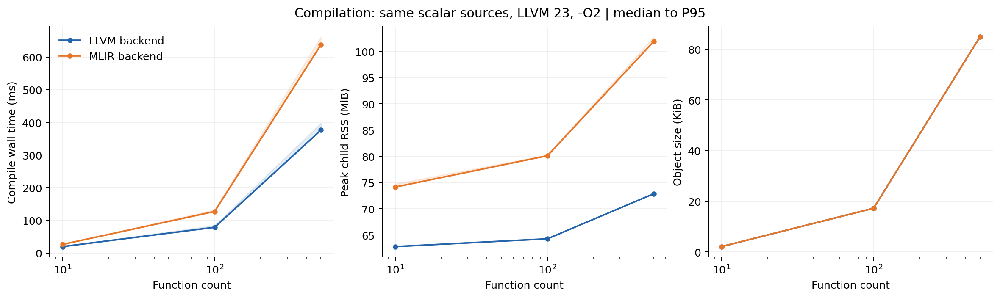
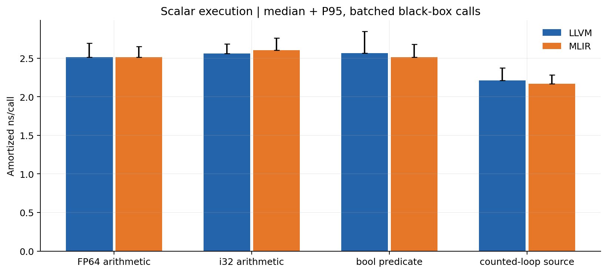
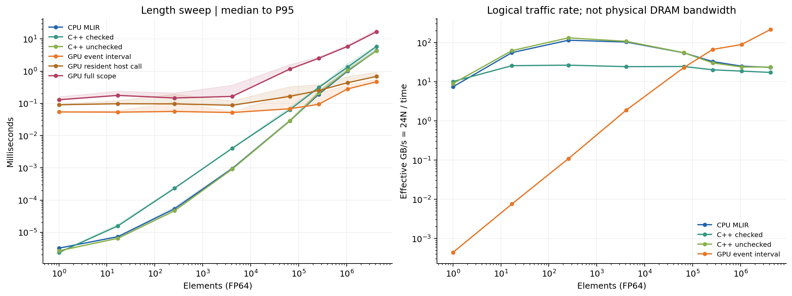
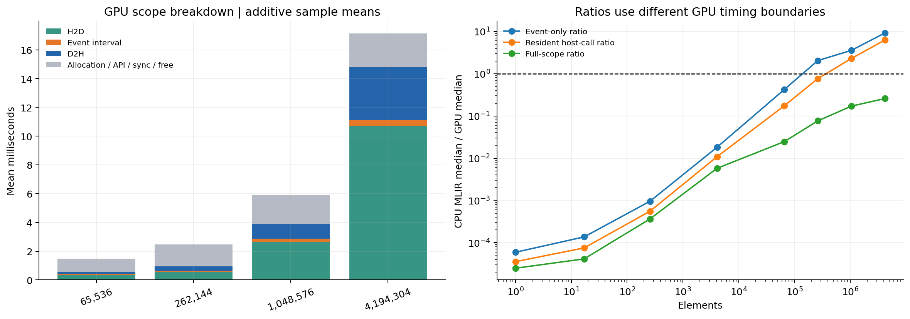
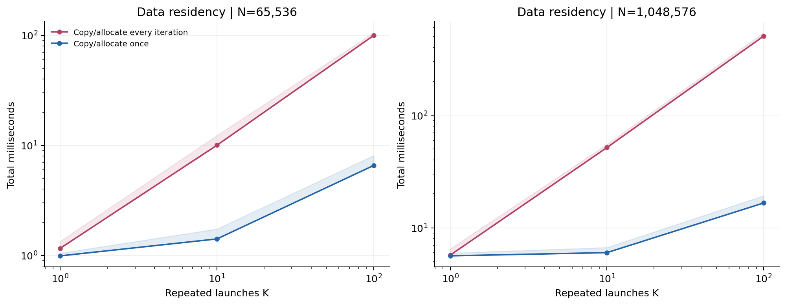
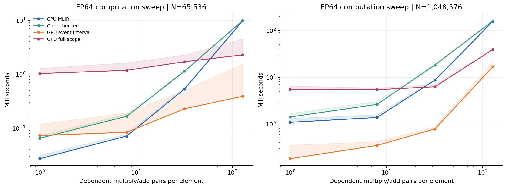
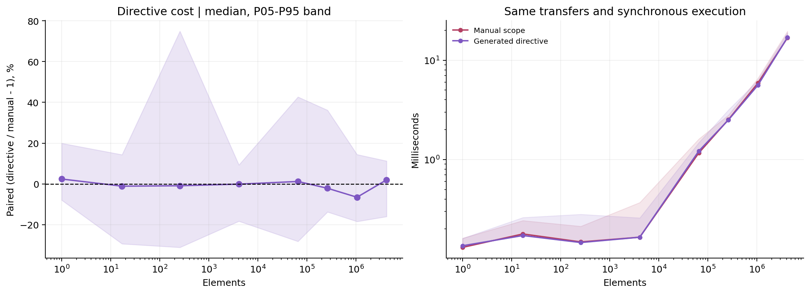
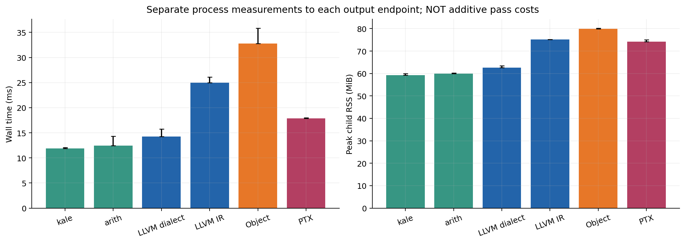

## Benchmarks: measured locally

**2026-11-14 · 12th Gen Intel(R) Core(TM) i7-12700H / NVIDIA GeForce RTX 3080 Ti Laptop GPU · LLVM 23.1.6 · CUDA 12.8.**
The suite covers compilation, scalar/vector execution, GPU event and end-to-end timing,
data residency, FP64 computation density, and teaching-directive overhead.
It retains 2766 runtime observations (including first-use records) and 84 compiler samples; no slow outliers are discarded.

| Representative result (median) | Measured |
| --- | ---: |
| 500 functions: original LLVM backend compilation | 376.215 ms |
| 500 functions: MLIR backend compilation | 637.649 ms (1.69×) |
| 1,048,576 elements: direct CPU MLIR execution | 1.006 ms |
| Same size: resident GPU event interval | 0.282 ms |
| Same size: resident GPU synchronous host call | 0.439 ms |
| Same size: complete GPU data scope | 5.887 ms |
| Same size, 128 multiply/add pairs: CPU / complete GPU scope | 157.223 / 39.320 ms (4.00×) |
| Same size, 100 launches: fresh scopes / one resident scope | 504.382 / 16.629 ms (30.33×) |

**In this local run, GPU computation is shorter, but full transfers make the simple FP64 vector operation slower end to end.**
Event-only ratios are not application speedups. Device-data reuse substantially reduces repeated allocation/copy cost.
Directive-versus-manual differences are noisy: paired P05–P95 ranges are retained rather than claiming a fixed overhead percentage.

### Methodology

- Identical FP64 inputs and arithmetic; vector samples verify all outputs and a host-side tail guard outside timing. Scalar backend parity is checked before timing.
- Runtime configurations: 5 warmups and 21 samples. Residency: 2 warmups and 7 samples. Compilation: 1 warmup and 7 samples.
- CPU direct calls are batched (1000 calls for N ≤ 257). Scalar ns/call includes call, loop and checksum accumulation; it is not instruction latency.
- Single-threaded measurement processes are pinned to WSL logical CPU 0. C++ baselines use Clang 23 -O2 with FP contraction disabled, without -march=native or fast-math.
- C++ checked retains array length checks; unchecked has weaker safety semantics. The CPU simulation includes extra copies and is not the GPU speedup baseline.
- CUDA uses synchronous APIs, pageable host memory and 256-thread blocks. Resident event intervals and synchronous host calls are recorded separately; first-use observations are excluded from steady-state summaries.
- Most plots show medians with bands/error bars up to P95. Cost decomposition uses means of the same samples to preserve additivity.
- Effective bandwidth uses logical traffic 24N/time. Repeated data can be cached; this is not a measurement of physical DRAM bandwidth.
- Computation density is 1/8/32/128 dependent multiply/add pairs; saved PTX retains the corresponding mul/add counts with no FMA or arithmetic elimination.
- Compiler stages are cumulative output endpoints measured in separate processes, not additive individual-pass costs.
- Residency consumes only the final result in both variants; it does not model an application that needs every intermediate result on the host.
- Frequencies are not locked. WSL scheduling, temperature, display activity and background load affect results. These are not universal hardware rankings or OpenACC V&V results.

### Compilation time, memory and object size



### Scalar execution



### Vector length and effective traffic rate



### GPU cost breakdown and timing boundaries



### Device data residency



### Increasing FP64 computation



### Teaching-directive overhead



### Compiler output endpoints



### Raw records and reproduction

[Runtime samples](runtime.csv) · [Compiler samples](compile.csv) ·
[Runtime summary](runtime_summary.csv) · [Compiler summary](compile_summary.csv) ·
[Environment, commands and source hashes](environment.json) · [Generated sources](sources/) · [LLVM IR/PTX](ir/)

Residency uses the lower-level runtime; current teaching directives still allocate and transfer on every call.
Charts are saved as PNG and SVG. The commands require an already configured MLIR/CUDA build
and Python matplotlib/numpy. Choose a fresh --out directory to preserve existing records.

[Measurement log](logs/benchmark-run.log) · [Regression test log](logs/regression-tests.log)

```bash
python3 benchmarks/run.py --out benchmarks/results/my-run
python3 benchmarks/plot.py benchmarks/results/my-run --update-readme
```
