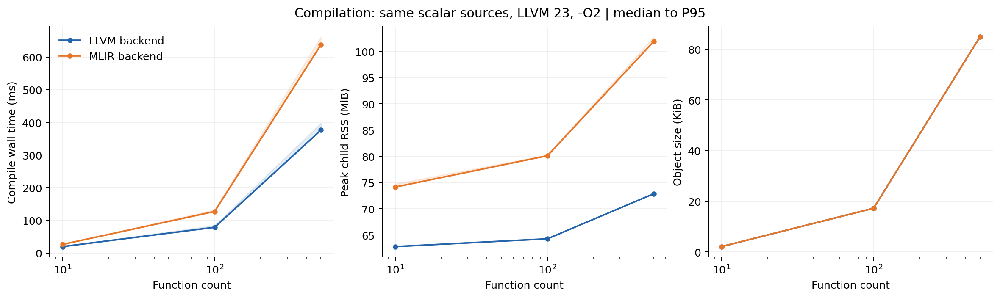
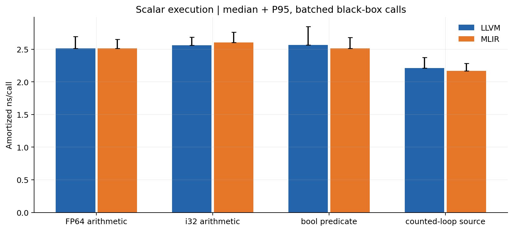
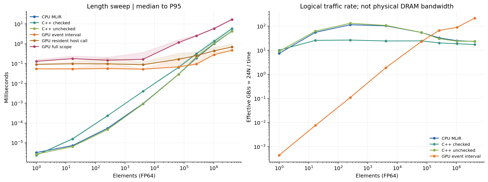
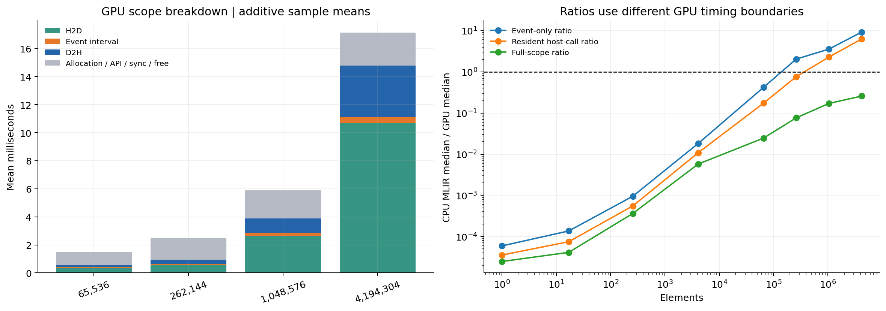
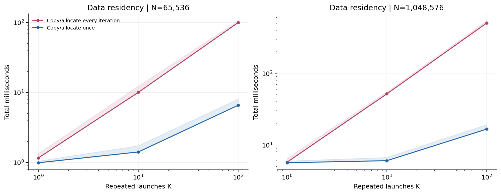
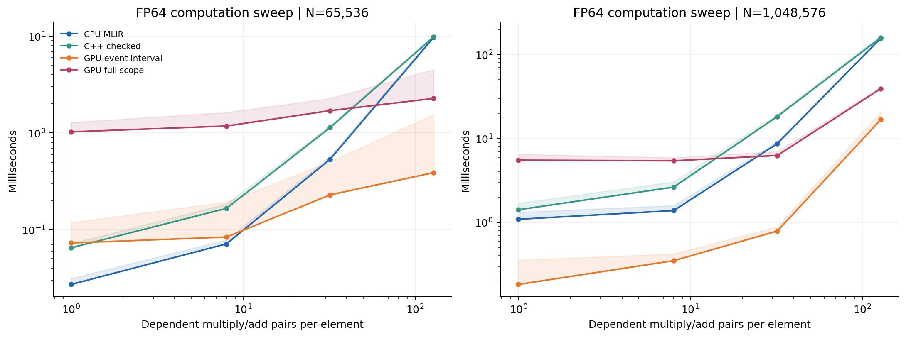
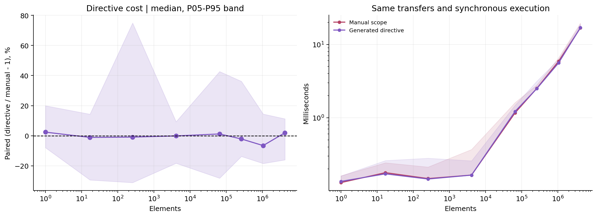
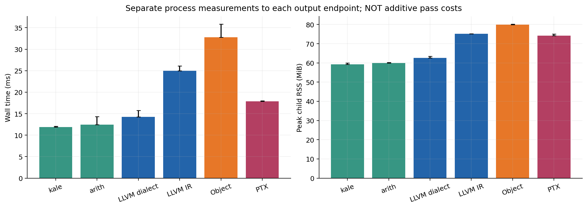

## Benchmark：本地实测

**2026-11-14 · 12th Gen Intel(R) Core(TM) i7-12700H / NVIDIA GeForce RTX 3080 Ti Laptop GPU · LLVM 23.1.6 · CUDA 12.8。**
本次完成编译、标量、向量、GPU 内核/端到端、数据驻留、计算量及教学指令开销测试。
保留 2766 条运行时观测（含首次使用记录）和 84 条编译样本；不删除异常慢样本。

| 代表性结果（中位数） | 实测 |
| --- | ---: |
| 500 个函数，原 LLVM 后端编译 | 376.215 ms |
| 500 个函数，MLIR 后端编译 | 637.649 ms（1.69×） |
| 1,048,576 元素，CPU MLIR 直接执行 | 1.006 ms |
| 同规模，GPU 驻留数据的 event 区间 | 0.282 ms |
| 同规模，GPU 驻留数据的同步宿主调用 | 0.439 ms |
| 同规模，GPU 完整数据区域 | 5.887 ms |
| 同规模，每元素 128 对乘加：CPU / GPU 完整区域 | 157.223 / 39.320 ms（4.00×） |
| 同规模重复 100 次：每次迁移 / 驻留一次 | 504.382 / 16.629 ms（30.33×） |

**结论：本机这次测量中，GPU 的计算阶段更短，但简单 FP64 向量运算的完整迁移流程更慢。**
不能把 event-only 的比值当作端到端加速比。复用设备数据显著降低了重复分配和传输成本。
教学指令相对手写调用的差异存在噪声，图中保留配对样本的 P05–P95，不宣称固定百分比开销。

### 测量口径

- CPU/GPU 使用相同 FP64 输入及运算；向量每个样本后检查全部结果和主机尾部哨兵，检查不计时。标量计时前验证双后端一致性。
- 运行时每项预热 5 次、测量 21 次；驻留实验预热 2 次、每项 7 次；编译每项预热 1 次、测量 7 次。
- CPU 直接执行使用批量计时；小于等于 257 元素批量 1000 次。标量报告包含调用、循环和校验和累加成本，不能解释为单条运算延迟。
- 单线程测量进程固定到 WSL 逻辑 CPU 0；C++ 基线为 Clang 23 -O2、关闭 FP contraction，未用 -march=native 或 fast-math。
- C++ checked 保留数组长度检查；unchecked 是较弱安全语义的参考。CPU 模拟运行时含额外复制，不作为 GPU 加速比基线。
- CUDA 使用同步 API、pageable 主机内存、256 线程块。驻留 event 时间与同步宿主调用时间分别保存；进程首次使用单独记录且不混入稳定样本，不代表硬件/系统缓存冷启动。
- 图中通常是中位数，淡色带/误差线延伸至 P95；阶段分解使用同一组样本的均值以保证可加和。
- 有效带宽按逻辑流量 24N/time 计算；重复访问可能命中缓存，不能据此称为实际 DRAM 带宽。
- 计算量采用 1/8/32/128 对有依赖的乘加；保存的 PTX 分别保留相同数量的 mul/add，未融合为 FMA、未折叠掉。
- 各编译输出阶段都是独立进程的累计端点耗时，不能相加或直接相减推断单个 Pass 成本。
- 数据驻留实验中只有最后一次结果被消费，两方案可观察结果相同；它不代表每轮都必须回传结果的工作负载。
- 未锁定 CPU/GPU 频率；WSL、温度、显示负载和后台程序会影响结果。本报告不是通用硬件排名或 OpenACC V&V 性能结论。

### 编译耗时、内存与目标文件大小



### 标量执行



### 数组长度与有效数据吞吐



### GPU 阶段占比与计时边界



### 设备数据驻留



### 增加 FP64 计算量



### 教学指令开销



### 编译输出阶段



### 原始记录与复现

[运行时原始 CSV](runtime.csv) · [编译原始 CSV](compile.csv) ·
[运行时汇总](runtime_summary.csv) · [编译汇总](compile_summary.csv) ·
[环境、命令与源码哈希](environment.json) · [生成源码](sources/) · [LLVM IR/PTX](ir/)

驻留实验调用底层运行时；当前教学指令每次仍重新分配和传输，不自动驻留。
图表同时提供 PNG 和 SVG。以下命令要求已配置好的 MLIR/CUDA 构建及 Python matplotlib/numpy；
--out 必须是新的目录，以免覆盖原始记录。

[测量日志](logs/benchmark-run.log) · [回归测试日志](logs/regression-tests.log)

```bash
python3 benchmarks/run.py --out benchmarks/results/my-run
python3 benchmarks/plot.py benchmarks/results/my-run --update-readme
```
